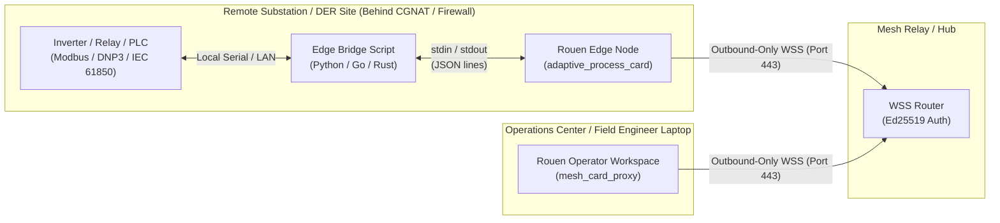
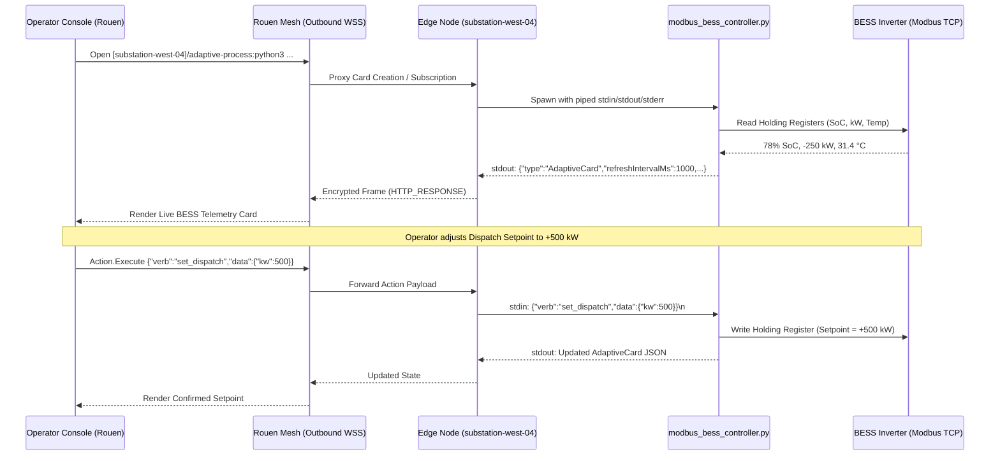

# Rouen for the Energy & Utilities Industry

Modern energy systems—spanning utility substations, Distributed Energy Resources (DERs), Battery Energy Storage Systems (BESS), wind and solar farms, microgrids, and upstream/midstream oil & gas telemetry—face two persistent engineering bottlenecks:

1. **Strict Network Isolation (The OT/IT Boundary)**: Field assets sit behind unidirectional firewalls, Carrier-Grade NAT (CGNAT) cellular modems, or satellite links (such as Starlink) where inbound connections are strictly prohibited by operational security standards (ISA/IEC 62443, NERC CIP).
2. **Protocol & Hardware Fragmentation**: Field sites run decades of heterogeneous hardware speaking Modbus RTU/TCP, DNP3, IEC 61850, OPC-UA, BACnet, CAN bus, and proprietary vendor serial protocols.

**Rouen** addresses both challenges through two native primitives—**Rouen Mesh** (outbound-only WebSocket federation) and **Adaptive Process Cards** (language-agnostic `stdio` sensor/control bridges)—which combine into a lightweight, zero-compile edge-to-control-room platform.

---

## 1. Outbound-Only WebSockets (`rouen_mesh_host`) for OT/IT Security

Traditional SCADA extensions and remote maintenance workflows often require complex site-to-site VPNs, jump hosts, or inbound firewall exceptions at remote sites.

### How Rouen Mesh Solves Connectivity
Implemented in [`rouen::mesh::rouen_mesh_host`](../src/hosts/rouen_mesh_host.hpp), every Rouen node connects to the mesh using a **single outbound TLS WebSocket (`wss://`)** connection:

* **Zero Inbound Ports**: Field gateways and substation edge PCs never listen on public interfaces or require port forwarding. They initiate an outbound connection on standard port `443`, traversing NAT, CGNAT, cellular, and corporate proxies cleanly.
* **Cryptographic Node Identity (Ed25519)**: Nodes authenticate via mutual **Ed25519 challenge-response signatures** ([`CRYPTOGRAPHIC_HANDSHAKE_SPEC.md`](CRYPTOGRAPHIC_HANDSHAKE_SPEC.md)), eliminating shared static passwords on field devices.
* **Multiplexed Binary Framing**: Over that single outbound WebSocket, Rouen multiplexes:
  * **Card & REST Proxying (`HTTP_REQUEST` / `HTTP_RESPONSE`)**: Querying live telemetry and submitting operator commands to remote edge nodes.
  * **Ephemeral State Registry (`REGISTRY_SET` / `REGISTRY_GET` / `REGISTRY_LIST`)**: Real-time presence, health heartbeats, and alarm state propagation across nodes.
  * **On-Demand TCP Tunneling (`ROUTE_OPEN` / `ROUTE_DATA`)**: Controlled, auditable point-to-point streams when engineering tools need direct access to an isolated device.



---

## 2. Adaptive Process Cards (`adaptive_process_card`) for Sensor & Protocol Integration

Integrating a new sensor, power meter, or legacy controller into an operator HMI traditionally requires custom driver compilation, vendor SDK licensing, or fragile web dashboards.

### How Adaptive Process Cards Work
Implemented in [`rouen::cards::adaptive_process_card`](../src/cards/information/adaptive_process_card.hpp) and documented in [`ADAPTIVE_PROCESS_CARDS.md`](ADAPTIVE_PROCESS_CARDS.md), the `adaptive-process:<command>` URI scheme turns **any executable or script in any language** into a live, interactive UI card using standard `stdin`, `stdout`, and `stderr`:

1. **Telemetry via `stdout` (1 Line = 1 Card State)**:
   Whenever the external process prints a compact JSON line conforming to the Adaptive Cards specification, Rouen immediately updates the live card UI. Top-level `"refreshIntervalMs"` hints drive automatic periodic polling (`"verb": "tick"`).
2. **Operator Control via `stdin` (1 Line = 1 Action Payload)**:
   When an operator clicks an action button (`Action.Submit` or `Action.Execute`)—such as *Update Active Power Setpoint*, *Reset Fault Latch*, or *Open Breaker*—Rouen serializes the form inputs into a single JSON line and writes it to the child process's `stdin`.
3. **Process Isolation & Live `stderr` Diagnostics**:
   Managed via [`rouen::helpers::piped_process`](../src/helpers/piped_process.hpp), each sensor script runs in an isolated OS process. If a serial bus hangs or a vendor SDK crashes, Rouen stays responsive, displays the exit status with a one-click **Restart** button, and captures `stderr` in a collapsible diagnostic pane directly on the card.

---

## 3. The "Killer Combo": Mesh Card Proxy + Adaptive Process

The true architectural leverage emerges when **Rouen Mesh** and **Adaptive Process Cards** are combined via [`rouen::cards::mesh_card_proxy`](../src/cards/interface/mesh_card_proxy.hpp).

Using Rouen's bracket URI syntax, an operator or engineer in a central control room can open a card running directly on a remote field asset:

```text
[substation-west-04]/adaptive-process:python3 /opt/grid/modbus_bess_controller.py --unit 1
```

### Why This Combination Is Transformative for Energy Operations



* **Protocol Termination at the Edge**: Raw industrial protocols (Modbus, DNP3, IEC 61850, serial RS-485) never leave the local substation LAN. Only compact, schema-validated JSON card states and explicit operator action payloads traverse the encrypted WebSocket mesh.
* **No Cloud Lock-In or Heavy Runtime Footprint**: Unlike heavyweight container/JVM/Electron stacks that struggle on resource-constrained industrial DIN-rail PCs, Rouen compiles to a single native C++20 binary with minimal memory overhead.
* **Rapid Field Customization**: If a site swaps a Schneider power meter for an ABB or SEL relay, a field engineer only updates the local Python/Go script on the edge node—the control room workspace immediately renders the updated card without redeploying Rouen.

---

## 4. Illustrative Edge Integration: BESS Modbus Controller

Below is a complete, self-contained example of an `adaptive-process` script in Python that bridges a Battery Energy Storage System (BESS) controller into Rouen (locally or across the mesh):

```python
#!/usr/bin/env python3
"""
Example Adaptive Process Card for a Battery Energy Storage System (BESS).
Launch locally:
  adaptive-process:python3 bess_card.py --site "Substation West 04"
Or remotely from any paired Rouen node over the Mesh:
  [substation-west-04]/adaptive-process:python3 /opt/rouen/bess_card.py
"""
import json
import sys
import time

state = {
    "site": "Substation West 04 - BESS Unit 1",
    "soc_pct": 78.4,
    "active_power_kw": -250.0,  # Negative = charging, Positive = discharging
    "setpoint_kw": -250.0,
    "rack_temp_c": 29.8,
    "breaker_closed": True,
    "last_updated": time.strftime("%H:%M:%S"),
}

def emit_card(status_note="Nominal"):
    mode = "DISCHARGING" if state["active_power_kw"] > 0 else ("CHARGING" if state["active_power_kw"] < 0 else "IDLE")
    card = {
        "type": "AdaptiveCard",
        "version": "1.5",
        "refreshIntervalMs": 2000,
        "body": [
            {"type": "TextBlock", "text": state["site"], "size": "large", "weight": "bolder"},
            {
                "type": "FactSet",
                "facts": [
                    {"title": "State of Charge (SoC)", "value": f"{state['soc_pct']:.1f} %"},
                    {"title": "Operating Mode", "value": mode},
                    {"title": "Active Power", "value": f"{state['active_power_kw']:+.1f} kW"},
                    {"title": "Rack Temperature", "value": f"{state['rack_temp_c']:.1f} °C"},
                    {"title": "Main Breaker", "value": "CLOSED" if state["breaker_closed"] else "OPEN (ISOLATED)"},
                    {"title": "Last Telemetry", "value": f"{state['last_updated']} ({status_note})"},
                ],
            },
            {
                "type": "Input.Number",
                "id": "setpoint_kw",
                "title": "Dispatch Setpoint (kW, -1000 to +1000)",
                "value": state["setpoint_kw"],
            },
        ],
        "actions": [
            {"type": "Action.Execute", "title": "Apply Setpoint", "verb": "apply_setpoint"},
            {"type": "Action.Execute", "title": "Toggle Breaker", "verb": "toggle_breaker"},
        ],
    }
    print(json.dumps(card), flush=True)

emit_card("Initial poll")

for raw_line in sys.stdin:
    line = raw_line.strip()
    if not line:
        continue
    try:
        msg = json.loads(line)
        verb = msg.get("verb", "")
        data = msg.get("data", msg)

        if verb == "apply_setpoint":
            state["setpoint_kw"] = float(data.get("setpoint_kw", state["setpoint_kw"]))
            if state["breaker_closed"]:
                state["active_power_kw"] = state["setpoint_kw"]
            note = f"Setpoint updated to {state['setpoint_kw']:+.1f} kW"
        elif verb == "toggle_breaker":
            state["breaker_closed"] = not state["breaker_closed"]
            if not state["breaker_closed"]:
                state["active_power_kw"] = 0.0
            note = "Breaker toggled by operator"
        else:
            # Periodic refresh tick ("verb": "tick")
            if state["breaker_closed"]:
                state["soc_pct"] = max(0.0, min(100.0, state["soc_pct"] - (state["active_power_kw"] * 0.0005)))
            note = "Live poll"

        state["last_updated"] = time.strftime("%H:%M:%S")
        emit_card(note)
    except Exception as exc:
        print(f"Telemetry error: {exc}", file=sys.stderr, flush=True)
        emit_card("Error processing command")
```

---

## 5. High-Value Energy Use Cases

| Use Case | Challenge | Rouen Value Proposition |
| :--- | :--- | :--- |
| **DER & Microgrid Fleet Management** | Dozens of behind-the-meter solar + storage sites behind customer firewalls and cellular NAT. | Outbound-only WebSocket mesh links every site to a single operator workspace with zero VPN maintenance. |
| **Substation & Relay Commissioning** | Field engineers run custom Python/IEC 61850/DNP3 scripts on laptops while coordinating with protection engineers at HQ. | Wrap existing test scripts as `adaptive-process:` cards; HQ engineers view and interact with the live test card over the mesh in real time. |
| **Pipeline & Wellhead Remote Telemetry** | Low-bandwidth satellite/cellular links where bloated web dashboards fail or consume excessive data. | Compact JSON-line updates over persistent binary WebSocket frames keep bandwidth minimal while preserving interactive control. |
| **Hardware-in-the-Loop (HIL) & Lab Benches** | Mixing thermal cameras, oscilloscopes, power analyzers, and custom serial rigs across multiple lab workstations. | Combine Rouen's native **Camera**, **Number Series**, and **Process Orchestrator** cards with **Adaptive Process** instrument drivers in one unified multi-card layout. |
