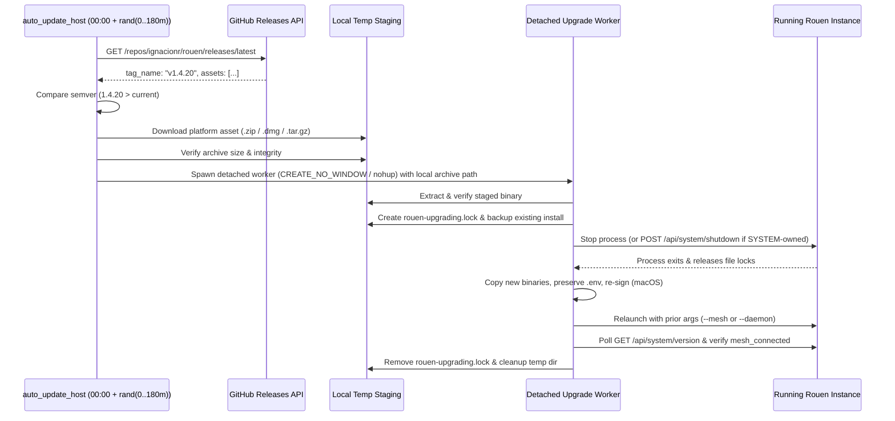

# Feature Request: Automatic Staggered Nightly Self-Update and Resilient Relaunch

**Date**: October 24, 2026  
**From**: Rouen Core Infrastructure & Mesh Reliability Team  
**To**: Rouen Architecture & Systems Maintainers  
**Status**: Open (Feature Specification RFC)  
**Target Components**:
- Auto-Update Scheduler & Host: `src/hosts/auto_update_host.hpp` / `src/hosts/auto_update_host.cpp` (new)
- Embedded HTTP API Upgrade Endpoint: [`src/hosts/api_server_host.cpp`](file:///Users/inz/src/rouen/src/hosts/api_server_host.cpp)
- Windows Detached Upgrade Script: [`scripts/upgrade-rouen.ps1`](file:///Users/inz/src/rouen/scripts/upgrade-rouen.ps1)
- POSIX (macOS / Linux) Detached Upgrade Script: [`scripts/upgrade-rouen.sh`](file:///Users/inz/src/rouen/scripts/upgrade-rouen.sh)
- System About / Settings UI: [`src/cards/system/about.hpp`](file:///Users/inz/src/rouen/src/cards/system/about.hpp)
- Unit & Regression Tests: `tests/test_auto_update.cpp`

**File Location**: [`inbox/2026-10-24-feat-automatic-nightly-self-update-and-relaunch.md`](file:///Users/inz/src/rouen/inbox/2026-10-24-feat-automatic-nightly-self-update-and-relaunch.md)

---

## 1. Executive Summary & Rationale

### 1.1 Overview
Rouen installations deployed across desktop workstations, laptops, and headless nodes frequently serve as critical mesh gateways tunneling remote access services (`ssh`, `rdp`, `rest_api`). Keeping all nodes on the latest release is essential for protocol compatibility and sync stability, but manual upgrades across remote nodes carry a high risk of lockout if Rouen terminates without reliably relaunching itself.

This feature introduces an **Automatic Nightly Self-Update Service** built into Rouen:
1. **Staggered Nightly Check Window (`00:00` – `03:00` Local Time)**: Each Rouen installation computes a random jitter offset between **0 and 180 minutes after local midnight** (`[0, 180]` minutes) each day and checks GitHub Releases (`GET https://api.github.com/repos/ignacionr/rouen/releases/latest`) at that scheduled time.
2. **Pre-Flight Download & Verification**: If a newer semantic version exists for the current platform (`windows-x64`, `macos`, `linux-x64`), Rouen downloads and validates the release archive in a temporary staging directory **before** stopping the running process.
3. **Zero-Lockout Detached Swap & Relaunch**: Rouen invokes the hardened platform upgrade pipeline (`upgrade-rouen.ps1` on Windows, `upgrade-rouen.sh` on macOS/Linux) in a genuinely independent background process that swaps the binaries, preserves `.env` and code signatures, relaunches Rouen in its prior runtime mode (`--mesh` or `--daemon`), and verifies `/api/system/version` and mesh reconnection—automatically rolling back if the new binary fails health checks.

### 1.2 Operational Lessons Learned (Critical Reliability Requirements)
Recent fleet upgrades surfaced five failure modes in the existing self-upgrade pipeline that **must** be addressed as part of this feature:

1. **Windows `CreateProcessA` with `DETACHED_PROCESS` + `powershell.exe -WindowStyle Hidden` Silently Aborts**:
   - In [`src/hosts/api_server_host.cpp`](file:///Users/inz/src/rouen/src/hosts/api_server_host.cpp#L5835-L5849), launching `powershell.exe -WindowStyle Hidden` with `CREATE_NEW_PROCESS_GROUP | DETACHED_PROCESS` detaches the child from any Win32 console (`GetConsoleWindow() == NULL`). When `-WindowStyle Hidden` is passed without a console handle, `powershell.exe` aborts during startup before executing a single line of `upgrade-rouen.ps1`, while `rouen.exe` still executes `std::exit(0)` 1,500 ms later—killing Rouen without performing the upgrade or relaunching.
   - **Requirement**: Spawn `powershell.exe` using `CREATE_NEW_PROCESS_GROUP | CREATE_NO_WINDOW` (`0x08000200`) **without** `-WindowStyle Hidden` (using `-NonInteractive`), and wait exclusively after pre-flight staging has already succeeded.

2. **Pre-Staging Before Termination**:
   - If `rouen.exe` calls `std::exit(0)` 1.5 seconds after `/api/system/upgrade` is invoked, the node goes offline while the script is still downloading a 20+ MB archive over the network. If the download fails or times out, or if internet connectivity depends on a local proxy, the upgrade fails while Rouen is already dead.
   - **Requirement**: The C++ `auto_update_host` (or the pre-shutdown phase of `/api/system/upgrade`) must download and verify the release package to a local path *while Rouen is still running*. Rouen should only exit once the detached worker has extracted and validated the staged executable and is ready for the atomic binary swap.

3. **Windows Session 0 (`--daemon` / `SYSTEM`) vs. Interactive Desktop Session (`SessionId > 0`, `--mesh`)**:
   - On Windows, Rouen may run either in an interactive user desktop session (`SessionId > 0` with `--mesh`) or in headless `Session 0` (`--daemon`, often launched by a `SYSTEM` scheduled task watchdog).
   - In [`scripts/upgrade-rouen.ps1`](file:///Users/inz/src/rouen/scripts/upgrade-rouen.ps1):
     - If the updater is already running inside an interactive desktop session (`SessionId > 0`), it should launch `rouen.exe --mesh` directly via `Start-Process` so it immediately attaches to the active desktop.
     - If the updater is running in `Session 0` and no interactive user session (`explorer` / `sihost`) is active, `schtasks.exe /create ... /it` (interactive-only) cannot launch a GUI process. `Start-RouenInteractive` must detect `Session 0` headless mode and launch `rouen.exe --daemon` directly instead of failing and rolling back.
     - Conversely, if an existing `rouen.exe` was started by `SYSTEM` in `Session 0` and an upgrade is triggered from a standard user session, `Stop-Process` returns `Access Denied`, leaving `rouen.exe` and its DLLs (`avcodec-61.dll`, etc.) locked. `upgrade-rouen.ps1` must fall back to requesting a graceful self-exit via `POST http://127.0.0.1:8081/api/system/shutdown` (or `/api/system/upgrade` self-exit) when `Stop-Process` cannot terminate the process.

4. **macOS `.dmg` / Linux `.tar.gz` Archive Formats & macOS TCC Code Signing**:
   - [`scripts/upgrade-rouen.sh`](file:///Users/inz/src/rouen/scripts/upgrade-rouen.sh) currently assumes `.zip` archives, whereas GitHub Releases publish `rouen-macos-universal.dmg` for macOS and `rouen-linux-x64.tar.gz` for Linux.
   - On macOS, replacing `Contents/MacOS/rouen` without signing `libpdfium.dylib` and ad-hoc signing `rouen` with the explicit designated requirement (`--requirements '=designated => identifier "com.rouen.app"'`) invalidates macOS TCC Accessibility permissions across updates. Moreover, `.env` must strictly reside in `Contents/Resources/.env` (never `Contents/MacOS/.env`).

5. **Watchdog Coexistence**:
   - Nodes running a periodic scheduled task watchdog (e.g., every 2 minutes) could race with the upgrade script during the brief window when `rouen` is stopped for binary replacement.
   - **Requirement**: Write a lockfile (`<install_dir>/rouen-upgrading.lock` containing the updater PID and timestamp, valid for up to 120 seconds) before stopping Rouen and remove it once relaunch completes, so external watchdogs do not prematurely respawn the half-copied binary during the 2–5 second swap window.

---

## 2. Technical Architecture & Component Specification

### 2.1 Staggered Nightly Scheduler (`auto_update_host`)
Create `rouen::hosts::auto_update_host` to manage automatic update checks and execution:

- **Configuration (Environment & Settings)**:
  - `ROUEN_AUTO_UPDATE_ENABLED`: Defaults to `true` (`1`). Can be toggled in `.env` or the System About card.
  - `ROUEN_AUTO_UPDATE_WINDOW_START_HOUR`: Defaults to `0` (`00:00` local time).
  - `ROUEN_AUTO_UPDATE_WINDOW_MINUTES`: Defaults to `180` (random offset in `[0, 180]` minutes after midnight, i.e., between `00:00:00` and `03:00:00` local time).
- **Schedule Calculation**:
  - On startup and after each daily check completes, `auto_update_host` computes the next local midnight (`00:00:00` of the next calendar day, or today if started right at midnight) and draws a uniform random offset `offset_seconds` in `[0, 180 * 60]` using `std::mt19937` seeded from `std::random_device`.
  - Logs the next scheduled check timestamp: e.g., `[auto-update] Next automatic update check scheduled for 2026-10-25 01:42:18 local time (+102m18s after midnight)`.
  - Uses a background `std::jthread` with `std::stop_token`-aware condition variable wait so application shutdown is never blocked.



### 2.2 Semantic Version Comparison & Asset Selection
- **Version Parsing**:
  - Parse `ROUEN_VERSION` (e.g., `"1.4.19"`) and GitHub's `tag_name` (stripping leading `'v'`, e.g., `"v1.4.20"` -> `(1, 4, 20)`).
  - Trigger an automatic upgrade only when `remote_version > local_version` strictly.
- **Platform Asset Matching**:
  - **Windows (`_WIN32`)**: Match asset name `rouen-windows-x64.zip` (preferred over `.msi` for unattended non-elevated silent binary replacement).
  - **macOS (`__APPLE__`)**: Match `rouen-macos-universal.dmg` (or `rouen-macos-universal.zip` if present).
  - **Linux (`__linux__`)**: Match `rouen-linux-x64.tar.gz`.

### 2.3 Hardening `POST /api/system/upgrade` in `api_server_host.cpp`
In [`src/hosts/api_server_host.cpp`](file:///Users/inz/src/rouen/src/hosts/api_server_host.cpp):
1. **Fix Windows Process Creation Flags**:
   - Replace `CREATE_NEW_PROCESS_GROUP | DETACHED_PROCESS` + `-WindowStyle Hidden` with `CREATE_NEW_PROCESS_GROUP | CREATE_NO_WINDOW` and `-NonInteractive`:
     ```cpp
     std::string cmd = std::format(
         "powershell.exe -ExecutionPolicy Bypass -NoProfile -NonInteractive -File \"{}\" -Source \"{}\" -InstallDir \"{}\" -Detached",
         script_path, req.source, exe_dir
     );
     BOOL success = CreateProcessA(
         NULL, cmd.data(), NULL, NULL, FALSE,
         CREATE_NEW_PROCESS_GROUP | CREATE_NO_WINDOW,
         NULL, exe_dir.c_str(), &si, &pi
     );
     ```
2. **Do Not Prematurely `std::exit(0)` Before Staging**:
   - Remove the unconditional 1,500 ms `std::exit(0)` timer from `handle_system_upgrade()` when starting an upgrade from a remote URL. Instead, add a dedicated local-only endpoint `POST /api/system/shutdown` (restricted to loopback `127.0.0.1` / `::1`) that the detached upgrade script calls at **Step 8** (after download, extraction, pre-flight binary validation, and backup are 100% complete).
   - This guarantees:
     - Rouen stays online during the entire download and extraction phase.
     - Even if `rouen.exe` is running as `NT AUTHORITY\SYSTEM` in `Session 0` and the upgrade script runs as a standard user, `POST http://127.0.0.1:8081/api/system/shutdown` cleanly exits the `SYSTEM` process right when the script is ready to swap the binaries.

### 2.4 Hardening `scripts/upgrade-rouen.ps1` (Windows)
Update [`scripts/upgrade-rouen.ps1`](file:///Users/inz/src/rouen/scripts/upgrade-rouen.ps1) with the following resilience improvements:
1. **Lockfile Management**:
   - Create `$InstallDir\rouen-upgrading.lock` before stopping `rouen.exe` and remove it in `finally {}` so `ensure-rouen.ps1` watchdogs skip intervention while an upgrade is actively swapping files.
2. **Graceful Self-Shutdown + `Stop-Process` Fallback**:
   - In Step 8 (`Stopping running Rouen instances...`), first send `Invoke-RestMethod -Method Post -Uri "http://127.0.0.1:8081/api/system/shutdown" -TimeoutSec 2` so `rouen.exe` flushes databases and exits cleanly regardless of user/SYSTEM ownership, then follow up with `Stop-Process -Force` for any remaining PIDs.
3. **Session-Aware Relaunch (`Start-RouenInteractive`)**:
   - Inspect `(Get-Process -Id $PID).SessionId` and active desktop processes (`explorer`, `sihost`):
     - If `(Get-Process -Id $PID).SessionId -gt 0`: launch `rouen.exe --mesh` directly via `Start-Process` in the current interactive session.
     - If `(Get-Process -Id $PID).SessionId -eq 0` and an interactive session exists: trigger a temporary `/it` scheduled task (`schtasks.exe`) to launch `rouen.exe --mesh` in the interactive desktop session.
     - If `(Get-Process -Id $PID).SessionId -eq 0` and no interactive user session exists (headless server / logged-off workstation): launch `rouen.exe --daemon` directly in `Session 0`.
4. **Post-Relaunch Health & Mesh Verification**:
   - Poll `http://127.0.0.1:8081/api/system/version` for up to 15 seconds after relaunch to confirm the new version responds and `mesh_connected` (or `mesh_auto_connect`) is active before marking the upgrade successful.
   - Prune old `backup_*` directories older than the 3 most recent backups so disk usage does not grow unboundedly over nightly updates.

### 2.5 Hardening `scripts/upgrade-rouen.sh` (macOS & Linux)
Update [`scripts/upgrade-rouen.sh`](file:///Users/inz/src/rouen/scripts/upgrade-rouen.sh):
1. **Support `.dmg` (macOS) and `.tar.gz` (Linux) Archives**:
   - On macOS, if `$SOURCE` is a `.dmg`, attach it read-only (`hdiutil attach -nobrowse -readonly -mountpoint "$STAGE_DIR/mnt" "$DMG_PATH"`), copy `Rouen.app/Contents/MacOS/rouen` and `libpdfium.dylib` to `$STAGE_DIR`, and detach (`hdiutil detach "$STAGE_DIR/mnt"`).
   - On Linux, if `$SOURCE` is a `.tar.gz`, extract with `tar -xzf "$ARCHIVE" -C "$STAGE_DIR/extracted"`.
2. **macOS Designated Code Signing & Bundle Hygiene**:
   - Ensure any `.env` inside `Contents/MacOS/.env` is migrated to `Contents/Resources/.env` and removed from `Contents/MacOS/`.
   - Sign `libpdfium.dylib` and sign `Contents/MacOS/rouen` with `--requirements '=designated => identifier "com.rouen.app"'`.
3. **Graceful Loopback Shutdown & Rollback**:
   - Request graceful shutdown via `curl -s -X POST http://127.0.0.1:8081/api/system/shutdown` before `pkill -x rouen`, swap binaries, relaunch with the previous launch arguments, and verify `http://127.0.0.1:8081/api/system/version`.

### 2.6 REST API & UI Observability
- **`GET /api/system/version` / `GET /api/system/update/schedule`**:
  - Expose auto-update status in JSON:
    ```json
    {
      "auto_update_enabled": true,
      "next_check_at": "2026-10-25T01:42:18-04:00",
      "random_offset_minutes": 102,
      "last_check_at": "2026-10-24T02:15:09-04:00",
      "last_check_result": "up_to_date",
      "latest_known_version": "1.4.19"
    }
    ```
- **System About Card ([`src/cards/system/about.hpp`](file:///Users/inz/src/rouen/src/cards/system/about.hpp))**:
  - Display the next scheduled nightly update check time, a checkbox to toggle automatic nightly updates (`ROUEN_AUTO_UPDATE_ENABLED`), and a **"Check & Update Now"** button.

---

## 3. Acceptance Criteria & Verification Plan

1. **Unit Tests (`tests/test_auto_update.cpp`)**:
   - Verify semantic version comparison (`1.4.19 < 1.4.20`, `1.4.19 == v1.4.19`, `1.4.20 > 1.4.9`, pre-release handling).
   - Verify next-check timestamp calculation guarantees a time strictly within `[00:00:00, 03:00:00]` local time (`0` to `180` minutes after midnight) across multiple random seeds and across DST / midnight boundary transitions.
   - Verify platform asset selector picks the right asset from a sample GitHub release JSON payload on Windows, macOS, and Linux.
2. **End-to-End Upgrade & Relaunch Verification**:
   - Trigger `/api/system/upgrade` on Windows (both interactive `--mesh` in `Session > 0` and headless `--daemon` in `Session 0` under `SYSTEM`) and on macOS.
   - Confirm Rouen downloads/stages the package before shutting down, swaps the binary, automatically relaunches within 10 seconds, restores all mesh virtual services (`rest_api`, `ssh`, `rdp`), and logs `[SUCCESS] === UPGRADE SUCCESSFUL! ===` to `rouen-upgrade.log`.
