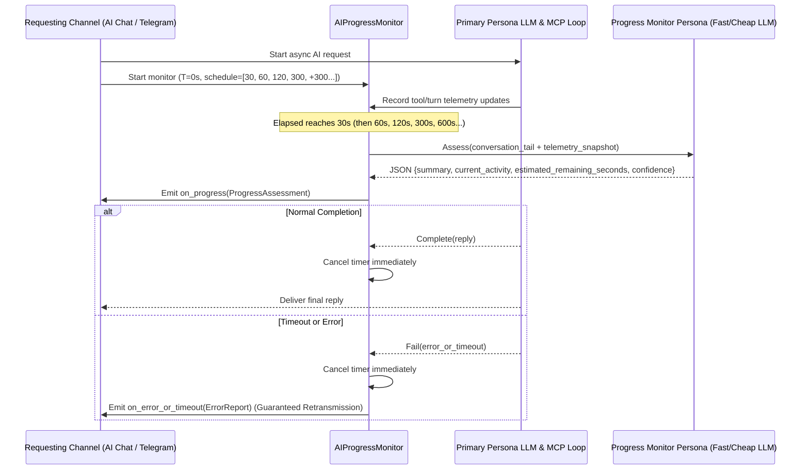

# Feature Request: AI Progress Monitor Persona, Escalating Interim Summaries, and Guaranteed Timeout/Error Retransmission Across Channels

**Date**: November 1, 2026  
**From**: Rouen AI Runtime & Multi-Channel UX Engineering  
**To**: Rouen Architecture, AI Host & Channel Maintainers  
**Status**: Open (Feature Specification RFC)  
**Target Components**:
- Persona Management & Defaults: [`src/helpers/persona_manager.hpp`](file:///Users/inz/src/rouen/src/helpers/persona_manager.hpp)
- LLM Host & Configuration: [`src/hosts/llm_host.hpp`](file:///Users/inz/src/rouen/src/hosts/llm_host.hpp), [`src/hosts/llm_host.cpp`](file:///Users/inz/src/rouen/src/hosts/llm_host.cpp), [`src/helpers/llm_config.hpp`](file:///Users/inz/src/rouen/src/helpers/llm_config.hpp)
- AI Chat Card: [`src/cards/information/ai_chat.hpp`](file:///Users/inz/src/rouen/src/cards/information/ai_chat.hpp), [`src/cards/information/ai_chat.cpp`](file:///Users/inz/src/rouen/src/cards/information/ai_chat.cpp)
- Telegram Host & Bot Routing: [`src/hosts/telegram_host.hpp`](file:///Users/inz/src/rouen/src/hosts/telegram_host.hpp), [`src/hosts/telegram_host.cpp`](file:///Users/inz/src/rouen/src/hosts/telegram_host.cpp), [`src/cards/information/telegram.cpp`](file:///Users/inz/src/rouen/src/cards/information/telegram.cpp)
- Shared AI Progress & Error Coordinator (New Native C++20 Module): `src/helpers/ai_progress_monitor.cppm` (module interface `rouen.helpers.ai_progress_monitor`), `src/helpers/ai_progress_monitor.cpp` (module implementation), and `src/helpers/ai_progress_monitor.hpp` (thin `import rouen.helpers.ai_progress_monitor;` bridge)
- Build System: [`CMakeLists.txt`](file:///Users/inz/src/rouen/CMakeLists.txt) (`rouen_modules` `FILE_SET CXX_MODULES`), [`tests/CMakeLists.txt`](file:///Users/inz/src/rouen/tests/CMakeLists.txt)
- Unit Tests: `tests/test_ai_progress_monitor.cpp`

**File Location**: [`inbox/2026-11-01-feat-ai-progress-monitor-persona-and-timeout-retransmission.md`](file:///Users/inz/src/rouen/inbox/2026-11-01-feat-ai-progress-monitor-persona-and-timeout-retransmission.md)

---

## 1. Executive Summary & Motivation

### 1.1 Problem Statement
Rouen AI orchestrates multi-step MCP tool invocations, hierarchical sub-persona delegations (`call_persona_*`), context compaction, and remote mesh queries. Because of this agentic tool loop, completing a request in Rouen AI inherently takes significantly longer than a single raw LLM completion call.

When a request runs for 30 seconds to several minutes—especially over asynchronous channels like **Telegram** ([`telegram_host`](file:///Users/inz/src/rouen/src/hosts/telegram_host.hpp)) or during deep multi-turn tool chains in **AI Chat** ([`ai_chat`](file:///Users/inz/src/rouen/src/cards/information/ai_chat.hpp))—the user is left without actionable feedback on whether:
1. The model is actively progressing through tool calls and sub-tasks, or
2. The request is hung, rate-limited, or has timed out / errored out silently.

Furthermore, if an HTTP timeout, provider fallback failure, or unhandled exception occurs deep inside a worker thread or sub-persona call, the requesting channel must **always** receive a clear, explicit timeout or error notification rather than failing silently or returning an empty completion.

### 1.2 Core Goals
1. **Selected Progress-Assessor Persona Bound to a Cheap, Fast LLM**:
   - Support selecting/binding a dedicated **Progress Monitor Persona** in [`PersonaManager`](file:///Users/inz/src/rouen/src/helpers/persona_manager.hpp) (with a sensible built-in default, e.g. `"Progress Monitor"`, and configurable selection in Settings / Persona UI) bound to a low-latency, low-cost LLM configuration (such as a fast Flash/Mini/Groq/local tier configured in [`LLMHost`](file:///Users/inz/src/rouen/src/hosts/llm_host.hpp)).
2. **Structured Progress & Remaining-Duration Assessment Prompt**:
   - Configure the Progress Monitor Persona with a system prompt engineered to inspect the current conversation context + live execution telemetry (elapsed time, completed internal turns, active/completed MCP tool calls, sub-persona delegations) and output:
     - A concise human-readable progress summary of what has been accomplished and what is currently running.
     - A **structured data point for estimated remaining duration** (e.g., `estimated_remaining_seconds` as an integer alongside `status` / `confidence`).
3. **Escalating Periodic Summary Schedule (30s, 1m, 2m, 5m, +5m...)**:
   - For any in-flight AI reply that runs for 30 seconds or longer, automatically trigger the Progress Monitor Persona to emit an interim progress & ETA update at:
     - **30 seconds** (`30s`)
     - **1 minute** (`60s`)
     - **2 minutes** (`120s`)
     - **5 minutes** (`300s`)
     - **Every 5 minutes thereafter** (`600s`, `900s`, `1200s`, ...) until the primary task finishes or is cancelled.
4. **Channel-Agnostic Architecture (AI Chat, Telegram, and Future Channels)**:
   - Implement the monitoring timer, telemetry snapshot collector, structured assessment parser, and error/timeout dispatcher in a reusable coordinator so **AI Chat**, **Telegram**, and any future requesting channel (REST API, Mesh RPC, Adaptive Cards) share identical mechanics.
5. **Guaranteed Timeout & Error Retransmission**:
   - Ensure that all HTTP/LLM timeouts (`CURLE_OPERATION_TIMEDOUT`, per-request deadlines, max tool iteration exhaustion), provider errors, and exceptions are deterministically caught, formatted with diagnostic context (elapsed time, last tool/persona step, error cause), and retransmitted back to the originating channel.

---

## 2. User Stories & Acceptance Criteria

### User Story 1: Dedicated Progress Monitor Persona on a Fast/Cheap Model
> **As a Rouen administrator or user**,  
> I want to designate a specific Persona as the **Progress Monitor Persona** and bind it to a cheap, low-latency LLM configuration,  
> so that periodic status checks execute in ~1–2 seconds with negligible token cost and without slowing down the primary reasoning model.

**Acceptance Criteria**:
- [`PersonaManager`](file:///Users/inz/src/rouen/src/helpers/persona_manager.hpp) maintains a configurable `progress_monitor_persona_name` (persisted in `PersonaSaveModel` / `PersonaActiveMeta` and synced via Universal Sync / Mesh Registry).
- A default built-in persona (e.g., `"Progress Monitor"`) is seeded if not present, pre-configured with:
  - Low temperature (`0.1f`), `"minimal"` / `"low"` thinking level, `max_tool_iterations = 0` (no recursive tool execution), and compact `max_output_tokens` (`512`).
  - Binding (`llm_config_name`) defaulting to the fastest/cheapest configured LLM profile (dynamically resolved from [`LLMHost`](file:///Users/inz/src/rouen/src/hosts/llm_host.hpp)).
  - System prompt instructing the model to assess conversation + execution trace and emit a structured JSON payload containing `summary`, `current_step`, `estimated_remaining_seconds`, and `confidence`.

### User Story 2: Structured Progress & Remaining-Duration Estimation
> **As a user waiting on a complex Rouen AI task**,  
> I want each interim update to tell me what the agent has done so far, what it is currently doing, and an approximate remaining duration as a structured data point,  
> so that both the UI (progress badges/timers in AI Chat) and messaging channels (formatted status messages in Telegram) can present accurate ETA information.

**Acceptance Criteria**:
- Define a Glaze-serializable struct `ProgressAssessment`:
  ```cpp
  struct ProgressAssessment {
      std::string summary;                     // Concise human-readable progress summary
      std::string current_activity;            // Current tool or reasoning phase
      int64_t estimated_remaining_seconds{-1}; // Structured remaining duration in seconds (-1 if unknown)
      std::string confidence{"medium"};        // "low", "medium", "high"
      int64_t elapsed_seconds{0};              // Populated by monitor coordinator
      uint32_t completed_turns{0};             // Completed internal tool/persona turns
  };
  ```
- If the Progress Monitor LLM returns JSON (or markdown-fenced JSON), parse `ProgressAssessment` via Glaze (`glz::read_json`). If raw text is returned or the fast LLM call fails, gracefully fall back to a deterministic telemetry summary constructed from live tool/turn state so the user still receives the scheduled heartbeat.

### User Story 3: Escalating Schedule (30s, 1m, 2m, 5m, every 5m)
> **As a user on AI Chat or Telegram**,  
> When my request takes 30 seconds or longer to complete,  
> I want automatic progress updates at **30s, 1m, 2m, 5m, and every 5m thereafter** until the reply finishes or is cancelled.

**Acceptance Criteria**:
- Schedule checkpoints (in elapsed seconds from request start):
  - `T = 30s`
  - `T = 60s` (1 minute)
  - `T = 120s` (2 minutes)
  - `T = 300s` (5 minutes)
  - `T = 300s + k * 300s` (`600s`, `900s`, `1200s`, ...) for `k >= 1`
- Timer loop uses condition-variable / stop-token wakeups so it cancels **immediately** (sub-millisecond) when the primary request finishes, errors out, or is cancelled by the user (`cancel_execution_`).
- In **AI Chat** ([`ai_chat`](file:///Users/inz/src/rouen/src/cards/information/ai_chat.cpp)):
  - Displays the latest `ProgressAssessment` (summary + formatted `estimated_remaining_seconds` countdown/badge) inside the live thinking bubble and/or interim status stream without corrupting the final assistant message bubble.
- In **Telegram** ([`telegram_host`](file:///Users/inz/src/rouen/src/hosts/telegram_host.cpp)):
  - Sends (or updates) a clearly formatted interim progress message to the requesting `chat_id` (e.g., `⏳ [1m 00s elapsed | ~45s remaining] ...`) at each checkpoint until completion or cancellation.

### User Story 4: Guaranteed Retransmission of Timeouts and Errors
> **As a user sending a request via AI Chat, Telegram, or any connected channel**,  
> If an LLM request, tool call, or sub-persona delegation times out or encounters an error,  
> I want the timeout or error to **always** be retransmitted to my requesting channel with clear diagnostic context.

**Acceptance Criteria**:
- Every channel execution path wraps completion in a guaranteed delivery guard:
  - **Timeouts**: Distinguish HTTP/curl timeouts (`timed out`, `Operation timed out`, deadline exceeded) and report a structured timeout notice to the channel (including elapsed duration, active persona, model name, and the last tool/step in progress).
  - **Errors & Empty Replies**: If primary + fallback LLM calls throw an exception, return an API error payload, or produce an empty response after tool execution, always transmit a clear error notification back to the originating channel (`chat_history_` in [`ai_chat`](file:///Users/inz/src/rouen/src/cards/information/ai_chat.cpp), `send_telegram_message(chat_id, ...)` in [`telegram_host`](file:///Users/inz/src/rouen/src/hosts/telegram_host.cpp), or the channel callback).
  - **Cancellation**: If cancelled by the user or shutdown, stop the progress monitor immediately and notify the channel that execution was cancelled.

---

## 3. Technical Architecture & Design

### 3.1 Progress Monitor Persona Specification (`src/helpers/persona_manager.hpp`)
1. **Extend `PersonaSaveModel` / `PersonaActiveMeta` & `PersonaManager`**:
   - Add `std::string progress_monitor_persona` to `PersonaSaveModel` and `PersonaActiveMeta` (defaulting to `"Progress Monitor"`).
   - Provide `get_progress_monitor_persona()` and `set_progress_monitor_persona(std::string_view name)` on [`PersonaManager`](file:///Users/inz/src/rouen/src/helpers/persona_manager.hpp).
2. **Default `"Progress Monitor"` Persona Definition**:
   - **Name**: `"Progress Monitor"`
   - **Description**: `"Fast, lightweight observer persona that summarizes in-flight task progress and estimates remaining completion time."`
   - **Allowed MCPs**: `{}` (read-only assessment; never invokes tools itself)
   - **System Prompt**:
     ```text
     You are the Rouen AI Progress Monitor. Your sole responsibility is to inspect an in-flight user request, recent conversation context, and live execution telemetry (elapsed seconds, completed internal turns, active and finished tool or persona calls) and produce a concise progress update with an approximate remaining duration.

     Respond ONLY with a valid JSON object matching this exact schema:
     {
       "summary": "<1-2 sentence user-friendly summary of current progress and what is happening right now>",
       "current_activity": "<short label for current step or tool>",
       "estimated_remaining_seconds": <integer approximate seconds remaining until completion, or -1 if unknown>,
       "confidence": "<low|medium|high>"
     }
     ```

### 3.2 Channel-Agnostic Execution Monitor as a Native C++20 Module (`src/helpers/ai_progress_monitor.cppm` & `.cpp`)
Implement `rouen::helpers::AIProgressMonitor` as a **native C++20 module** (`export module rouen.helpers.ai_progress_monitor;`) registered in the `rouen_modules` static library target in [`CMakeLists.txt`](file:///Users/inz/src/rouen/CMakeLists.txt#L566-L591) (`FILE_SET CXX_MODULES FILES`), following the exact pattern established by [`config_service.cppm`](file:///Users/inz/src/rouen/src/helpers/config_service.cppm) and [`tag_manager.cppm`](file:///Users/inz/src/rouen/src/helpers/tag_manager.cppm):

1. **Primary Module Interface Unit (`src/helpers/ai_progress_monitor.cppm`)**:
   - Places only minimal standard library headers (`<chrono>`, `<cstdint>`, `<functional>`, `<memory>`, `<string>`, `<string_view>`, `<vector>`) in the Global Module Fragment (`module;`).
   - Declares `export module rouen.helpers.ai_progress_monitor;` and exports `ProgressAssessment`, `ExecutionTelemetrySnapshot`, `ErrorTransmissionReport`, `next_progress_checkpoint_seconds()`, and `AIProgressMonitor` (using the PIMPL or clean member layout so heavy dependencies like Glaze, `http::fetch`, and `LLMHost` stay strictly inside the `.cpp` implementation unit).
2. **Module Implementation Unit (`src/helpers/ai_progress_monitor.cpp`)**:
   - Declares `module rouen.helpers.ai_progress_monitor;` and encapsulates Glaze JSON parsing (`glz::read_json`), `PersonaManager` lookup, `LLMHost` completion calls, condition-variable timer thread management, and timeout/error classification.
   - Keeps heavy template instantiations (`glaze`, `cppgpt`, `GeminiAdapter`) out of consumers (`ai_chat.cpp`, `telegram_host.cpp`, `api_server_host.cpp`), preventing compile-time and per-job RAM bloat (critical under Rouen's `-j2` / 16 GB RAM build constraint).
3. **Compatibility Bridge (`src/helpers/ai_progress_monitor.hpp`)**:
   - Thin 1-line bridge (`import rouen.helpers.ai_progress_monitor;`) for any legacy translation units that still use `#include`.



#### Schedule Helper Function
Expose a pure, unit-testable schedule function:
```cpp
// Returns the next checkpoint in seconds after `last_checkpoint_seconds`:
// 0 -> 30 -> 60 -> 120 -> 300 -> 600 -> 900 -> ...
constexpr int64_t next_progress_checkpoint_seconds(int64_t last_checkpoint_seconds) noexcept {
    if (last_checkpoint_seconds < 30) return 30;
    if (last_checkpoint_seconds < 60) return 60;
    if (last_checkpoint_seconds < 120) return 120;
    if (last_checkpoint_seconds < 300) return 300;
    return ((last_checkpoint_seconds / 300) + 1) * 300;
}
```

### 3.3 Integration in AI Chat (`src/cards/information/ai_chat.hpp`, `src/cards/information/ai_chat.cpp`)
- Attach `AIProgressMonitor` when `send_message_to_llm_with_functions()` / `send_message_to_llm()` dispatches the worker thread.
- Feed live tool executions (`execute_function_with_debug`, `execute_persona_call`, `internal_turn_count_`) into the monitor's telemetry state.
- When `on_progress(const ProgressAssessment&)` fires at 30s, 1m, 2m, 5m, +5m:
  - Store the latest `ProgressAssessment` and history of checkpoints on `ai_chat` (protected by mutex) and render it inside the thinking/activity area in `ai_chat::render()` (showing the progress summary, current activity, and structured `~Xs remaining` / `~Xm Ys remaining` badge).
- In thePersona configuration UI (`render_llm_controls()`), allow the user to designate which Persona acts as the **Progress Monitor Persona**.
- Ensure all timeout or exception paths in `send_message_to_llm_with_functions()`, `send_message_to_llm()`, and `execute_persona_call()` invoke the guaranteed error/timeout formatter so the user always sees an explicit `[Timeout after Xs]` or `[Error]` assistant message in `chat_history_`.

### 3.4 Integration in Telegram (`src/hosts/telegram_host.hpp`, `src/hosts/telegram_host.cpp`)
- In `telegram_host::route_incoming_message()` / `run_ai_persona_completion()`:
  - Instantiate `AIProgressMonitor` for the `chat_id` request before invoking `run_ai_persona_completion()`.
  - Hook tool/sub-persona execution (`execute_function_with_mcp_and_persona`) to record active/completed tool names and turn counts in the monitor.
  - On each checkpoint (`30s`, `60s`, `120s`, `300s`, `600s`, ...), send a formatted Telegram message via `send_telegram_message(chat_id, formatted_progress)` containing:
    - Elapsed time (`30s`, `1m`, `2m`, `5m`, ...)
    - Structured remaining duration estimate (`~45s remaining`, `~2m remaining`, or `estimating...`)
    - The Progress Monitor Persona's summary of completed & in-flight work.
  - allow `/cancel` or `/stop` command in Telegram to cancel an in-flight request for that `chat_id`.
  - Guarantee that any timeout, exception, LLM misconfiguration, or empty completion in `run_ai_persona_completion()` or the routing thread is always transmitted back to `chat_id` via `send_telegram_message()` with clear diagnostic details.

---

## 4. Verification & Testing Plan

1. **Unit Tests (`tests/test_ai_progress_monitor.cpp`)**:
   - **Checkpoint Schedule Calculation**: Verify `next_progress_checkpoint_seconds()` produces the exact sequence `30 -> 60 -> 120 -> 300 -> 600 -> 900 -> 1200`.
   - **Structured Assessment Parsing & Fallback**:
     - Verify `ProgressAssessment` JSON parsing (valid JSON, markdown-fenced JSON, and fallback telemetry formatting when JSON is malformed or LLM is unavailable) accurately extracts `estimated_remaining_seconds`, `summary`, `current_activity`, and `confidence`.
   - **Progress Monitor Persona Management**:
     - Verify [`PersonaManager`](file:///Users/inz/src/rouen/src/helpers/persona_manager.hpp) seeds/resolves the `"Progress Monitor"` persona, persists selection changes, and binds to a fast LLM config.
   - **Timer Trigger & Early Cancellation**:
     - Verify that with accelerated/mocked clock intervals, callbacks fire at the scheduled checkpoints and stop immediately upon task completion or cancellation without firing late callbacks.
   - **Guaranteed Timeout & Error Retransmission**:
     - Verify that simulated timeouts (`Operation timed out`) and exceptions in channel execution always invoke the channel's error delivery callback with structured timeout/error details.
2. **Build & Deployment Verification**:
   - Build with `nix develop --command cmake --build build --target rouen -j2` (strictly respecting `-j2` parallelism).
   - Deploy and sign `$HOME/Applications/Rouen.app` per repository rules.
