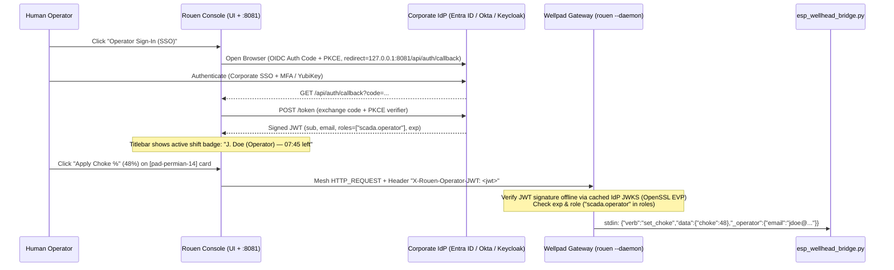

# Feature Request: OIDC / OAuth 2.0 SSO Operator Identity & Offline Edge JWT Verification

- **Date**: 2026-11-01
- **Type**: `feat`
- **Target Sector**: Energy & Utilities / Oil & Gas Control Rooms (API RP 1164, PHMSA CRM, NERC CIP-004/007, ISA/IEC 62443)
- **Status**: Open

---

## 1. Problem Statement & Motivation

[`rouen::mesh::rouen_mesh_host`](../src/hosts/rouen_mesh_host.cpp#L112-L135) currently authenticates **machine identity** (the workstation or remote edge gateway) using an Ed25519 keypair. However, in 24/7 Gas Control, Pipeline SCADA, and Utility Substation control rooms:

1. **Shared Shift Consoles**: Multiple human operators rotate across the same physical control room workstations across 8- or 12-hour shifts.
2. **Individual Human Attribution**: Regulatory standards (**API RP 1164**, **PHMSA Control Room Management**, **NERC CIP-004/007**, and **ISA/IEC 62443**) mandate that every control command (e.g., changing a choke setpoint, actuating an ESD valve, or acknowledging/shelving an alarm) be attributed to an **authenticated human operator** (`sub`, `email`, `name`, `roles`) verified against the enterprise Identity Provider (**Microsoft Entra ID / Azure AD, Okta, PingFederate, or Keycloak**).
3. **Prerequisite for RBAC, SBO & Alarm Acknowledgment**: Role-Based Access Control ([`2026-11-01-feat-select-before-operate-rbac-audit-log.md`](2026-11-01-feat-select-before-operate-rbac-audit-log.md)) and ISA-18.2 Alarm Acknowledgment ([`2026-11-01-feat-isa-18-2-industrial-alarm-lifecycle.md`](2026-11-01-feat-isa-18-2-industrial-alarm-lifecycle.md)) require a verified human operator session before evaluating permissions or writing audit logs.

---

## 2. Proposed Architecture & Design (Zero New C++ Dependencies)

Because Rouen already links **OpenSSL 3 (`EVP_PKEY` / `EVP_DigestVerify`)**, **libcurl ([`http::fetch`](../src/helpers/fetch.hpp))**, **Mongoose HTTP server ([`api_server_host`](../src/hosts/api_server_host.hpp) on `:8081`)**, and **Glaze JSON**, we can implement a complete OIDC SSO + Offline Edge Verification pipeline without adding any external libraries.



### A. `rouen::services::auth_service` (`src/helpers/auth_service.hpp`)
1. **OIDC Discovery & Configuration (`.env` / `rouen.ini`)**:
   - `ROUEN_OIDC_ISSUER_URL` (e.g., `https://login.microsoftonline.com/<tenant>/v2.0` or `https://sso.energy-corp.com/realms/ot`)
   - `ROUEN_OIDC_CLIENT_ID`
   - `ROUEN_OIDC_SCOPES` (default: `openid profile email`)
   - `ROUEN_OIDC_ROLE_CLAIM` (default: `roles` or `groups`)
2. **Primary Flow — OAuth 2.0 Authorization Code + PKCE**:
   - Generates a cryptographic 32-byte random `code_verifier`, computes `code_challenge = BASE64URL(SHA256(code_verifier))`, and opens the IdP authorization URL via [`rouen::platform::open_url()`](../src/helpers/platform_utils.hpp) with `redirect_uri=http://127.0.0.1:8081/api/auth/callback`.
   - [`api_server_host`](../src/hosts/api_server_host.cpp) handles `GET /api/auth/callback`, exchanges `code` + `code_verifier` at the IdP's `token_endpoint` via [`http::fetch`](../src/helpers/fetch.hpp), and stores the signed JWT (`id_token` / `access_token`) in volatile memory.
3. **Fallback Flow — OAuth 2.0 Device Authorization Grant (RFC 8628)**:
   - For locked-down control room kiosks without a local web browser, `auth_service` requests a device code from the IdP and displays the short verification URL + `user_code` on the `auth:` card so the operator can complete MFA sign-in on their corporate phone.
4. **Shift Session Hygiene & Fast Shift Handover (`auth:` Card + Titlebar Pill)**:
   - Render an always-visible **Operator Identity Pill** in the main menu/titlebar (`👤 J. Doe [scada.operator] • 07:42 remaining • [Lock / Handover]`).
   - Support one-click **Shift Handover / Lock** (and configurable idle auto-lock, e.g., `ROUEN_OPERATOR_IDLE_TIMEOUT_SEC=900`) that immediately clears the in-memory JWT and requires the next operator to sign in.

### B. Mesh Propagation (`X-Rouen-Operator-JWT`) & Offline Edge Verification
1. **Header Injection on Mesh Proxied Requests**:
   - When [`mesh_card_proxy`](../src/cards/interface/mesh_card_proxy.hpp) or `rouen_mesh_host` sends an `HTTP_REQUEST` frame to a remote peer, it automatically includes `X-Rouen-Operator-JWT: <compact_jwt>` if an operator session is active.
2. **Offline Cryptographic JWT Verification at the Edge (OpenSSL `EVP_DigestVerify`)**:
   - Remote wellpad and substation gateways running `rouen --daemon` often sit on restricted networks without direct internet access to `okta.com` or `login.microsoftonline.com`.
   - The edge node loads the IdP's **JWKS (JSON Web Key Set)** public keys (either from a local file `ROUEN_OIDC_JWKS_PATH`, fetched on startup, or replicated via the Rouen Mesh ephemeral registry under `auth/jwks`).
   - Using OpenSSL 3 (`EVP_DigestVerifyInit` / `EVP_DigestVerify` for `RS256`, `ES256`, or `EdDSA`), the edge node cryptographically validates:
     - JWT digital signature against the matching `kid` in the JWKS
     - Token expiration (`exp` + configurable clock-skew tolerance)
     - Issuer (`iss`) and Audience (`aud`)
   - Returns a strongly-typed `verified_operator_identity` struct (`sub`, `email`, `name`, `roles`, `auth_time`, `exp`).

### C. Verified `"_operator"` Attribution Injected into `adaptive-process` `stdin`
- When [`adaptive_process_card`](../src/cards/information/adaptive_process_card.hpp) receives an `Action.Execute` or `Action.Submit` payload (locally or via `POST /api/cards/action`), it strips any untrusted client-supplied `"_operator"` key and injects the cryptographically verified operator identity before writing the JSON line to the child process's `stdin`:

```json
{
  "verb": "set_choke",
  "data": { "choke_pct": 48.0 },
  "_operator": {
    "sub": "00u1a2b3c4",
    "email": "jdoe@permian-energy.com",
    "name": "Jane Doe",
    "roles": ["scada.operator", "pad-permian-14"],
    "workstation_node": "gas-control-desk-02",
    "auth_time": 1793586000
  }
}
```

---

## 3. Affected Files

- `src/helpers/auth_service.hpp` (new — PKCE generator, OIDC token exchange, OpenSSL JWT/JWKS verifier)
- `src/cards/system/auth_card.hpp` (new — `auth:` card for SSO sign-in, RFC 8628 device code display, active shift status, and shift handover)
- [`src/hosts/api_server_host.hpp`](../src/hosts/api_server_host.hpp) & [`src/hosts/api_server_host.cpp`](../src/hosts/api_server_host.cpp) (`/api/auth/callback`, `/api/auth/status`, and `X-Rouen-Operator-JWT` extraction)
- [`src/cards/interface/mesh_card_proxy.hpp`](../src/cards/interface/mesh_card_proxy.hpp) (propagating `X-Rouen-Operator-JWT` over mesh HTTP requests)
- [`src/cards/information/adaptive_process_card.hpp`](../src/cards/information/adaptive_process_card.hpp) (injecting verified `"_operator"` into `stdin` action lines)

---

## 4. Verification & Unit Test Plan

1. Add unit tests in `tests/` generating test RSA (`RS256`), ECDSA (`ES256`), and `EdDSA` keypairs via OpenSSL, signing mock OIDC JWTs, and verifying that `auth_service::verify_jwt()` accepts valid tokens and rejects expired (`exp`), tampered-payload, wrong-issuer (`iss`), or unknown-key (`kid`) tokens.
2. Add unit tests verifying that `adaptive_process_card` strips spoofed `"_operator"` fields from untrusted input payloads and injects the verified `verified_operator_identity` into the `stdin` JSON line.
