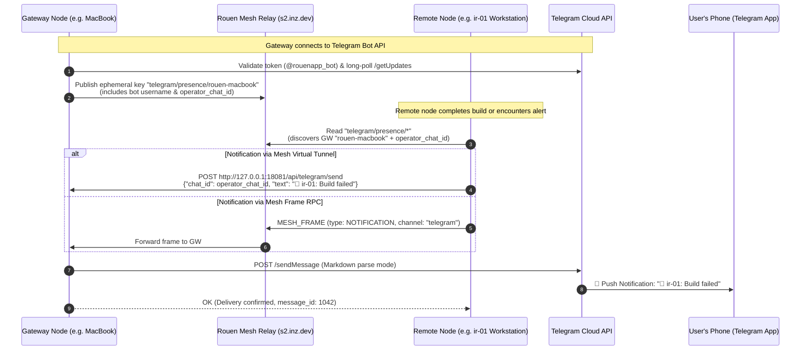

# Feature Request: Mesh-Wide Telegram Presence & Urgent Notification Gateway

## Summary

Design and implement a **Telegram Presence & Urgent Notification Relay** leveraging the Rouen Mesh.

### Primary Goal
**Any Rouen instance across the mesh can communicate with the user via Telegram**—particularly for **urgent system notifications, build alerts, alarms, and background task completions**—without needing each machine to maintain its own Telegram Bot token or configuration.

### Scope & Role Separation
* **Chatting with AI Personas**: Coordinated primarily by whichever single instance is directly connected to Telegram (managing local LLMs, MCP tools, and multi-turn context without distributed state desynchronization).
* **Remote Mesh Instances**: Act as **producers/emitters** that discover the active Telegram gateway via an **ephemeral registry key** (`telegram/presence/{client_id}`) and forward urgent alerts and messages directly to the operator's phone.

---

## Motivation & Real-World Use Cases

1. **Remote Workstations (`ir-01`, `ir-02`) Overnight Operations**:
   Long-running tasks running on remote Windows/Linux workstations (e.g. headless trading harness builds, compiler runs, regression tests) need to wake or alert the operator on their phone when an error occurs or a batch finishes. Currently, if the user is away from their desk, local text-to-speech (`say` / `System.Speech`) speaks into an empty room.
   
2. **Avoiding Telegram Bot API Token Conflicts**:
   Running Telegram polling (`/getUpdates`) with the same bot token on multiple machines causes immediate HTTP `409 Conflict` errors. Dedicated tokens per machine require juggling multiple bot conversations. With mesh presence, **one node serves as the active gateway** while all other nodes route through it.

3. **Smart Notification Escalation (Desktop -> Telegram)**:
   Rouen's [`presence_service`](file:///Users/inz/src/rouen/src/helpers/presence_service.hpp) already tracks user presence across workstations. If the user is actively working at a workstation, alerts can be delivered via desktop audio/visuals. If the user is idle on all mesh nodes, or if an alert is marked `urgent`, Rouen automatically escalates the notification to Telegram.

---

## Architecture & Data Flow



---

## Detailed Specification

### 1. Ephemeral Presence Registry Schema

When an instance of Rouen achieves `Status::Active` on Telegram while connected to the mesh, it writes an ephemeral record under:
`telegram/presence/{client_id}`

#### DTO Definition (`telegram_presence_record` in `src/hosts/telegram_host.hpp`):
```json
{
  "client_id": "rouen-ignacios-macbook-air",
  "hostname": "Ignacio-MacBook-Air.local",
  "platform": "macos",
  "bot_username": "rouenapp_bot",
  "bot_first_name": "Rouen Assistant",
  "operator_chat_id": 6885715531,
  "status": "active",
  "local_api_port": 8081,
  "capabilities": [
    "send_notification",
    "send_message",
    "read_sessions"
  ],
  "last_seen_epoch_ms": 1759410195000,
  "last_seen_iso": "2026-10-02T10:05:00Z"
}
```

#### Key Fields:
* `operator_chat_id`: The Telegram user/chat ID of the primary operator (obtained from the most recent active session, explicit config, or default route). This allows remote nodes to notify the user without needing hardcoded chat IDs.
* `status`: `"active"` indicates the gateway is actively polling and ready to relay messages.
* `local_api_port`: Rouen's embedded HTTP API port (default `8081`), accessible across mesh virtual routes.

#### Ephemeral Teardown Guarantee:
* Marked `ephemeral = true`.
* When the gateway disconnects, sleeps, or quits, `rouen-service` purges all client ephemeral keys (`purge_client_entries`). Remote nodes immediately detect that the gateway is offline and will not queue into a dead endpoint.

---

### 2. Presence Synchronization & Reconnect Resilience

Following the self-healing patterns established in `inbox/done_bug_presence_purged_on_reconnect_and_startup_race.md`:

1. **Telegram Connect**:
   When `telegram_host::validate_token_and_fetch_bot_info()` succeeds:
   ```cpp
   publish_telegram_presence();
   ```
2. **Mesh Connect / Reconnect**:
   In [`rouen_mesh_host::on_ws_connected`](file:///Users/inz/src/rouen/src/hosts/rouen_mesh_host.cpp#L352):
   If `telegram_host::get_host()->get_status() == Status::Active`, immediately re-publish `telegram/presence/{client_id}` so the gateway registration is restored instantly after network roaming or sleep-wake.
3. **Periodic Heartbeat**:
   Every 30–60 seconds, `telegram_host` touches the presence record to keep `last_seen_epoch_ms` updated.
4. **Token Removal / Disconnect**:
   When the token is cleared or polling stops, explicitly invoke `rouen_mesh_host::instance().delete_registry_value("telegram/presence/" + client_id)`.

---

### 3. Smart Notification Integration (`presence_service`)

Extend Rouen's central notification pipeline in [`src/helpers/presence_service.hpp`](file:///Users/inz/src/helpers/presence_service.hpp):

#### Extended `route_notification`:
```cpp
struct notification_options {
    std::string channel{"auto"}; // "auto", "desktop", "telegram", "both"
    bool urgent{false};
    bool spoken{true};
    int64_t target_chat_id{0}; // 0 = auto-resolve from gateway presence
};

std::pair<bool, std::string> route_notification(
    const std::string& message,
    const std::string& explicit_target = "",
    const notification_options& options = {}
);
```

#### Routing Logic:
1. **Direct Telegram Request (`channel == "telegram"`)**:
   Route directly to Telegram. If the local instance is the gateway, call `telegram_host::send_telegram_message`. Otherwise, forward to the active mesh gateway.
2. **Urgent Alerts (`options.urgent == true`)**:
   Always dispatch to Telegram **in addition to** triggering the local desktop alert (`channel = "both"`), ensuring the user is notified on mobile even if away from their screen.
3. **Idle Escalation (`channel == "auto"`)**:
   If all workstations across the mesh are idle (`is_all_idle() == true`) and no user interactions occurred in the last 5 minutes, automatically escalate desktop notifications to Telegram.

---

### 4. Remote Transport Pipeline

When a remote node needs to dispatch a message to the Telegram Gateway:

```
Remote Node (ir-01) ──(Mesh Virtual Route 18081:8081)──> Gateway Node (MacBook:8081) ──> Telegram Bot API
```

#### Step-by-Step Dispatch:
1. **Discovery**: Remote node queries `rouen_mesh_host::instance().get_registry_entries("telegram/presence/")`.
2. **Gateway Selection**: Selects the entry with `status == "active"` and newest `last_seen_epoch_ms`.
3. **Virtual Tunnel**: Ensures an active virtual route exists to the gateway's port 8081:
   ```cpp
   mesh_host.open_virtual_route(gw.client_id, gw.local_api_port, err, 18081);
   ```
4. **HTTP Dispatch**: Sends `POST http://127.0.0.1:18081/api/telegram/send`:
   ```json
   {
     "chat_id": gw.operator_chat_id,
     "text": "🚨 *[ir-01]* Compiler regression detected in test_order_books.cpp\nDuration: 42s"
   }
   ```
5. **Fallback to Mesh Notifications**: If port tunnels are restricted, fallback to native mesh notification frame `send_mesh_notification(gw.client_id, message)`.

---

### 5. API & CLI Enhancements

#### A. Extended `/api/notify` REST Endpoint ([`api_server_host.cpp`](file:///Users/inz/src/rouen/src/hosts/api_server_host.cpp))
```http
POST /api/notify HTTP/1.1
Content-Type: application/json

{
  "message": "Production benchmark completed on ir-02",
  "channel": "telegram",
  "urgent": true
}
```

#### B. CLI Invocation ([`src/rouen.cpp`](file:///Users/inz/src/rouen/src/rouen.cpp))
Allow headless jobs and shell scripts to notify via Telegram:
```bash
# Explicit Telegram notification
rouen --notify "Nightly backup failed" --telegram

# Urgent notification (speaks locally + pushes to Telegram)
rouen --notify "Power failure detected" --urgent
```

#### C. MCP Tool for Autonomous Agents ([`src/hosts/mcp_host.cpp`](file:///Users/inz/src/rouen/src/hosts/mcp_host.cpp))
```json
{
  "name": "notify_operator_telegram",
  "description": "Sends an urgent push notification directly to the operator's phone via the Mesh Telegram gateway.",
  "parameters": {
    "type": "object",
    "properties": {
      "message": { "type": "string", "description": "Markdown formatted message" },
      "urgent": { "type": "boolean", "default": true }
    },
    "required": ["message"]
  }
}
```

---

### 6. UI Indicator in [`telegram_card`](file:///Users/inz/src/cards/information/telegram.cpp)

On remote instances that do not hold a Telegram bot token:
* Display an unobtrusive status pill in the card header:
  `🟢 Mesh Relay Active: @rouenapp_bot (via rouen-ignacios-macbook-air)`
* Add a quick "Send Test Notification" button in the card to verify remote connectivity across the mesh.

---

## Affected Files & Components

| Component | File | Proposed Modification |
| :--- | :--- | :--- |
| **Telegram Host** | [`src/hosts/telegram_host.hpp`](file:///Users/inz/src/rouen/src/hosts/telegram_host.hpp)<br>[`src/hosts/telegram_host.cpp`](file:///Users/inz/src/rouen/src/hosts/telegram_host.cpp) | Define `telegram_presence_record`, add `publish_presence()` / `unpublish_presence()`, track `operator_chat_id`, and implement remote send helpers. |
| **Mesh Host** | [`src/hosts/rouen_mesh_host.cpp`](file:///Users/inz/src/rouen/src/hosts/rouen_mesh_host.cpp) | Re-publish Telegram presence inside `on_ws_connected()` on reconnect. |
| **Presence Service** | [`src/helpers/presence_service.hpp`](file:///Users/inz/src/rouen/src/helpers/presence_service.hpp) | Upgrade `route_notification()` to accept `channel` (`"telegram"`) and `urgent` flags, with auto-escalation when idle. |
| **API Server** | [`src/hosts/api_server_host.cpp`](file:///Users/inz/src/rouen/src/hosts/api_server_host.cpp) | Update `handle_notify()` to support `"channel": "telegram"` and `"urgent": true`. Add `/api/telegram/presence` endpoint. |
| **CLI Dispatcher** | [`src/rouen.cpp`](file:///Users/inz/src/rouen/src/rouen.cpp) | Add `--telegram` and `--urgent` CLI flags to `--notify`. |
| **MCP Agent Tools** | [`src/hosts/mcp_host.cpp`](file:///Users/inz/src/rouen/src/hosts/mcp_host.cpp) | Register `notify_operator_telegram` tool for autonomous personas. |
| **Unit Tests** | `tests/test_telegram_mesh_notify.cpp` | Verify presence discovery, notification routing, and mock relay execution. |

---

## Verification & Testing Plan

1. **Presence Publication Test**:
   * Start Rouen on Gateway with valid Telegram token.
   * Verify with `curl http://localhost:8081/api/mesh/registry?prefix=telegram/presence` that the key appears with `status: active` and valid `operator_chat_id`.
2. **Disconnect / Purge Test**:
   * Stop Rouen or toggle mesh connection on Gateway.
   * Verify from remote node (`ir-01`) that the key vanishes immediately from the registry.
3. **Remote Notification Test**:
   * On remote node `ir-01` (with no local Telegram token configured):
     `rouen --notify "Test urgent notification from ir-01" --telegram`
   * Confirm the message is forwarded across the mesh tunnel to Gateway and arrives on Telegram as a push notification.
4. **Idle Escalation Test**:
   * Put local node into idle state (`>300s` inactive).
   * Trigger `POST /api/notify` with `urgent: true`.
   * Verify notification is sent to Telegram automatically.
