# Feature Request: Gemini Multi-Model Roster Integration & Persona Responsibility Specialization

## Summary

Expand Rouen's Gemini LLM configuration beyond a single monolithic profile by introducing a curated roster of specialized Gemini models verified via live catalog discovery. Reconfigure the entire **Hierarchical AI Persona System** in `personas.json` and [`PersonaManager`](file:///Users/inz/src/rouen/src/helpers/persona_manager.hpp) so that each persona tier (Master Orchestrator, Deep Autonomous Engineers & Meta-Architects, Domain Group Leads, and Gated Leaf Specialists) leverages the optimal Gemini model matching its functional scope and reasoning requirements.

---

## Motivation & Problem Statement

### 1. Monolithic Model Bottleneck
In Rouen's current configuration (`~/Library/Application Support/rouen/personas.json` and `src/helpers/persona_manager.hpp`):
- Every single persona—from `Autonomous Engineer` performing full-lifecycle C++ TDD to `Terminal Specialist` running a single `ls` command—is configured with `llm_config_name: "Gemini Flash"`.
- This creates severe operational imbalances:
  - Complex reasoning and full-lifecycle coding tasks (such as running multi-turn compiler feedback loops, patching AST modules, and running CTest) demand cutting-edge reasoning depth and high tool-calling fidelity.
  - Minimalist utility personas (such as reading note archives, executing shell commands, or querying address books) suffer from unnecessary token overhead and higher latency when forced to use full orchestrator-grade models.
  - Multi-agent delegation between orchestrators and sub-personas benefits greatly from distinct model perspectives and specialized tool-calling optimizations.

### 2. New Frontier Model Availability (`gemini-4-argon`)
With the introduction and live availability of Google's flagship model **`gemini-4-argon`**, Rouen has access to unprecedented reasoning, complex tool orchestration, and autonomous engineering power. Pairing `gemini-4-argon` with high-speed, lightweight models (`gemini-3.5-flash-lite`) and balanced orchestrators (`gemini-3.8-flash`) enables a true heterogeneous multi-agent architecture.

---

## Live Endpoint Model Discovery & Verification

Per Rouen project rules (*"Never guess or hardcode static LLM model identifiers... Always query the LLM backend endpoint dynamically"*), a live catalog query was executed against the Generative Language API endpoint:

```bash
curl -s "https://generativelanguage.googleapis.com/v1beta/models?key=${GEMINI_API_KEY}" \
  | jq -r '.models[] | select(.supportedGenerationMethods[] | contains("generateContent")) | "\(.name) | \(.displayName) | \(.description)"'
```

### Verified Active Models Selected for Rouen

| Model Identifier | Display Name | Category & Strengths | Target Responsibilities in Rouen |
|---|---|---|---|
| **`models/gemini-4-argon`** | **Gemini 4 Argon** | Flagship frontier intelligence, deep logical reasoning, complex code generation, autonomous self-correction loops. | **Deep Engineering & Meta-Architecture**: `Autonomous Engineer`, `Persona Architect`. |
| **`models/gemini-3.8-flash`** | **Gemini 3.8 Flash** | Fast, high-capacity balanced multimodal model with broad context, strong prompt comprehension, and rapid tool calling. | **Primary Orchestration & UI Design**: `Rouen Assistant`, `Adaptive Card Architect`, `Media & Knowledge Director`, `Personal Productivity Lead`. |
| **`models/gemini-3.1-pro-preview-customtools`** | **Gemini 3.1 Pro Preview Custom Tools** | Specialized model fine-tuned specifically for precise schema parsing, multi-turn function calling, and structured tool hierarchies. | **Technical Group Coordination**: `Code & Git Architect`. |
| **`models/gemini-3.5-flash-lite`** | **Gemini 3.5 Flash Lite** | Ultra-low latency, lightweight token footprint, high throughput, deterministic tool execution. | **Gated Leaf Specialists**: `Terminal Specialist`, `Editor Specialist`, `Git & GitHub Specialist`, `Archiver of all data`, `Directory & Address Book`, `Schedule & Timekeeper`, `Financial Analyst`, `System Health & Metrics`, `Mesh Specialist`. |

---

## Proposed Architecture & Configuration

```mermaid
flowchart TD
    subgraph UI["Rouen Desktop & Daemons"]
        USER["User / Operator / Telegram"]
    end

    subgraph Tier1["Tier 1: Master Orchestration"]
        RA["Rouen Assistant\n(Gemini 3.8 Flash)\nTemp: 0.1 | Thinking: high"]
    end

    subgraph Tier2["Tier 2: Deep Engineers & Architects"]
        AE["Autonomous Engineer\n(Gemini 4 Argon)\nTemp: 0.1 | Thinking: high"]
        PA["Persona Architect\n(Gemini 4 Argon)\nTemp: 0.2 | Thinking: high"]
        CGA["Code & Git Architect\n(Gemini Pro Custom Tools)\nTemp: 0.2 | Thinking: high"]
        ACA["Adaptive Card Architect\n(Gemini 3.8 Flash)\nTemp: 0.2 | Thinking: high"]
        MKD["Media & Knowledge Director\n(Gemini 3.8 Flash)\nTemp: 0.3 | Thinking: medium"]
        PPL["Personal Productivity Lead\n(Gemini 3.8 Flash)\nTemp: 0.2 | Thinking: low"]
    end

    subgraph Tier3["Tier 3: Gated Leaf Specialists (Gemini Flash Lite)"]
        TERM["Terminal Specialist\nTemp: 0.1 | Thinking: minimal"]
        EDIT["Editor Specialist\nTemp: 0.1 | Thinking: low"]
        GIT["Git & GitHub Specialist\nTemp: 0.1 | Thinking: low"]
        NOTE["Archiver of all data\nTemp: 0.0 | Thinking: minimal"]
        CONT["Directory & Address Book\nTemp: 0.1 | Thinking: minimal"]
        TIME["Schedule & Timekeeper\nTemp: 0.1 | Thinking: minimal"]
        FIN["Financial Analyst\nTemp: 0.1 | Thinking: minimal"]
        METR["System Health & Metrics\nTemp: 0.1 | Thinking: minimal"]
        MESH["Mesh Specialist\nTemp: 0.1 | Thinking: minimal"]
    end

    USER --> RA
    RA -->|call_persona_| AE
    RA -->|call_persona_| PA
    RA -->|call_persona_| CGA
    RA -->|call_persona_| ACA
    RA -->|call_persona_| MKD
    RA -->|call_persona_| PPL

    CGA -->|call_persona_| EDIT
    CGA -->|call_persona_| TERM
    CGA -->|call_persona_| GIT
    CGA -->|call_persona_| ACA

    MKD -->|call_persona_| NOTE
    PPL -->|call_persona_| NOTE
    PPL -->|call_persona_| CONT
    PPL -->|call_persona_| TIME
```



### 1. Named LLM Profiles in `LLMConfigManager`

Add four distinct Gemini profiles to `src/hosts/llm_host.cpp` in `LLMConfigManager::ensure_standard_configs()`:

```cpp
// 1. Flagship Frontier Reasoning & Coding
LLMConfigEntry argon_entry{
    .name = "Gemini 4 Argon",
    .provider = "gemini",
    .api_key = gemini_key,
    .base_url = "https://generativelanguage.googleapis.com",
    .model_name = "gemini-4-argon",
    .thinking_level = "high"
};

// 2. Fast Balanced Orchestrator (Primary Default)
LLMConfigEntry flash_entry{
    .name = "Gemini 3.8 Flash",
    .provider = "gemini",
    .api_key = gemini_key,
    .base_url = "https://generativelanguage.googleapis.com",
    .model_name = "gemini-3.8-flash",
    .thinking_level = "high"
};

// 3. Tool-Calling Specialist
LLMConfigEntry pro_tools_entry{
    .name = "Gemini Pro Custom Tools",
    .provider = "gemini",
    .api_key = gemini_key,
    .base_url = "https://generativelanguage.googleapis.com",
    .model_name = "gemini-3.1-pro-preview-customtools",
    .thinking_level = "high"
};

// 4. Ultra-Fast Lightweight Leaf Specialist
LLMConfigEntry lite_entry{
    .name = "Gemini Flash Lite",
    .provider = "gemini",
    .api_key = gemini_key,
    .base_url = "https://generativelanguage.googleapis.com",
    .model_name = "gemini-3.5-flash-lite",
    .thinking_level = "minimal"
};
```

*Backward Compatibility*: Retain an alias or redirect for `"Gemini Flash"` pointing to `"gemini-3.8-flash"`.

---

### 2. Comprehensive Persona Reconfiguration Matrix

Every persona is updated with specific model bindings, temperature, thinking levels, iteration budgets, and token limits:

| Persona Name | Role & Responsibility Tier | Bound LLM Profile | Model Name | Temp | Thinking Level | Max Iter | Max Output Tokens |
|---|---|---|---|---|---|---|---|
| **`Autonomous Engineer`** | Tier 2: Full-Lifecycle Autonomous C++ Engineer | `Gemini 4 Argon` | `gemini-4-argon` | `0.1` | `high` | 100 | 16384 |
| **`Persona Architect`** | Tier 2: Meta-Prompt & Persona Designer | `Gemini 4 Argon` | `gemini-4-argon` | `0.2` | `high` | 50 | 8192 |
| **`Code & Git Architect`** | Tier 2: Technical Group Lead & Tool Router | `Gemini Pro Custom Tools` | `gemini-3.1-pro-preview-customtools` | `0.2` | `high` | 100 | 16384 |
| **`Rouen Assistant`** | Tier 1: Master Coordinator & Orchestrator | `Gemini 3.8 Flash` | `gemini-3.8-flash` | `0.1` | `high` | 100 | 16384 |
| **`Adaptive Card Architect`**| Tier 2: UI/UX & Adaptive Process Engineer | `Gemini 3.8 Flash` | `gemini-3.8-flash` | `0.2` | `high` | 50 | 16384 |
| **`Media & Knowledge Director`**| Tier 2: Media, Feeds & Web Research Director | `Gemini 3.8 Flash` | `gemini-3.8-flash` | `0.3` | `medium` | 20 | 8192 |
| **`Personal Productivity Lead`**| Tier 2: Personal Organization Lead | `Gemini 3.8 Flash` | `gemini-3.8-flash` | `0.2` | `low` | 20 | 8192 |
| **`Terminal Specialist`** | Tier 3: Gated Shell Command Runner | `Gemini Flash Lite` | `gemini-3.5-flash-lite` | `0.1` | `minimal` | 15 | 8192 |
| **`Editor Specialist`** | Tier 3: Gated File Inspector & Editor | `Gemini Flash Lite` | `gemini-3.5-flash-lite` | `0.1` | `low` | 20 | 8192 |
| **`Git & GitHub Specialist`** | Tier 3: Gated Git Version Control | `Gemini Flash Lite` | `gemini-3.5-flash-lite` | `0.1` | `low` | 20 | 8192 |
| **`Archiver of all data`** | Tier 3: Precision Notes Librarian | `Gemini Flash Lite` | `gemini-3.5-flash-lite` | `0.0` | `minimal` | 10 | 8192 |
| **`Directory & Address Book`** | Tier 3: Address Book & Contacts Manager | `Gemini Flash Lite` | `gemini-3.5-flash-lite` | `0.1` | `minimal` | 10 | 8192 |
| **`Schedule & Timekeeper`** | Tier 3: Calendar & Alarms Manager | `Gemini Flash Lite` | `gemini-3.5-flash-lite` | `0.1` | `minimal` | 10 | 8192 |
| **`Financial Analyst`** | Tier 3: Crypto Market & Orderbook Analyst | `Gemini Flash Lite` | `gemini-3.5-flash-lite` | `0.1` | `minimal` | 10 | 8192 |
| **`System Health & Metrics`** | Tier 3: Frame Rate & Performance Monitor | `Gemini Flash Lite` | `gemini-3.5-flash-lite` | `0.1` | `minimal` | 10 | 8192 |
| **`Mesh Specialist`** | Tier 3: Mesh Network & P2P Diagnostics | `Gemini Flash Lite` | `gemini-3.5-flash-lite` | `0.1` | `minimal` | 10 | 8192 |
| **`Media & Stream Director`** | Tier 3: Player & Cast Feed Controller | `Gemini 3.8 Flash` | `gemini-3.8-flash` | `0.2` | `low` | 15 | 8192 |

---

## Technical Implementation Plan

1. **Update `src/hosts/llm_host.cpp`**:
   - In `ensure_standard_configs()`:
     - Register `Gemini 4 Argon`, `Gemini 3.8 Flash`, `Gemini Pro Custom Tools`, and `Gemini Flash Lite`.
     - Automatically replicate `GEMINI_API_KEY` across all four Gemini entries if present in `ConfigService`.
     - Set default configuration to `"Gemini 3.8 Flash"`.

2. **Update `src/helpers/persona_manager.hpp`**:
   - In `setup_default_personas()`:
     - Apply the specialized `llm_config_name` mappings from the matrix above.
   - In `sanitize_and_migrate_personas()`:
     - Add migration checks to automatically upgrade existing configurations stored in `~/Library/Application Support/rouen/personas.json`.
     - If a persona's `llm_config_name` is `"Gemini Flash"` or `"Default"`, migrate it to its corresponding specialized profile (`Gemini 4 Argon` for Autonomous Engineer / Persona Architect, `Gemini Pro Custom Tools` for Code & Git Architect, `Gemini Flash Lite` for leaf specialists).
     - Trigger `save_personas()` and mesh sync hooks upon migration.

3. **Update Documentation (`docs/AI.md`)**:
   - Revise Section 2 ("Supported Providers & Standard Profiles") to document the four standard Gemini profiles.
   - Revise Section 4 ("Multi-Tier Hierarchy Example") and Section 8 to reflect model specialization per persona.

4. **Testing (`tests/`)**:
   - Add unit test in `tests/test_gemini_adapter.cpp` or a new test `tests/test_persona_multi_model.cpp`:
     - Test that `LLMConfigManager` creates all 4 Gemini profiles.
     - Test that `PersonaManager::sanitize_and_migrate_personas()` correctly maps personas to their respective profiles.
     - Test that invoking an LLM instance for `Autonomous Engineer` resolves to `gemini-4-argon`, and `Terminal Specialist` resolves to `gemini-3.5-flash-lite`.

---

## Acceptance Criteria

- [ ] All four Gemini profiles (`Gemini 4 Argon`, `Gemini 3.8 Flash`, `Gemini Pro Custom Tools`, `Gemini Flash Lite`) are registered and accessible in `LLMConfigManager`.
- [ ] Existing `personas.json` on disk automatically migrates to the specialized model profiles upon startup.
- [ ] Autonomous Engineer and Persona Architect run on `gemini-4-argon`.
- [ ] Code & Git Architect runs on `gemini-3.1-pro-preview-customtools`.
- [ ] Rouen Assistant runs on `gemini-3.8-flash`.
- [ ] Leaf utility specialists run on lightweight, low-latency `gemini-3.5-flash-lite`.
- [ ] Unit tests pass and verify configuration integrity and model assignment.
