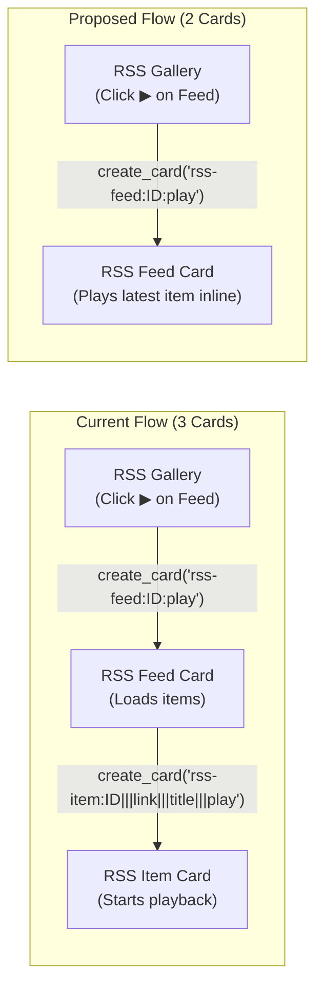

# Feature Request: Direct Media Playback on RSS Feed Card from Gallery Play Shortcut

## Summary

Simplify the RSS Gallery (`rss`) "Play Latest Item" shortcut workflow so that clicking the play button on a feed tile opens (or focuses) the **RSS Feed Card (`rss_feed`)** and plays the latest item's media **directly on the feed card**, avoiding the unnecessary creation and opening of a third **RSS Item Card (`rss_item`)**.

---

## Motivation & Problem Statement

Rouen's RSS subsystem uses three distinct card types:
1. **RSS Gallery (`rss`, URI: `rss`)** — Displays the grid of subscribed feeds with freshness indicators and a quick-play shortcut button (`ICON_MD_PLAY_ARROW`).
2. **RSS Feed (`rss_feed`, URI: `rss-feed:<feed_id>`)** — Displays the list of items for a specific feed, complete with inline `media_player::player` controls, TTS article reading, and a "Continuous Play" mode.
3. **RSS Item (`rss_item`, URI: `rss-item:<feed_id>|||<link>|||<title>`)** — Displays a dedicated reader/detail view for a single item.

### Current Behavior (Three-Card Hop)
1. On the RSS Gallery card ([`rss::render_feed_list`](file:///Users/inz/src/rouen/src/cards/information/rss.cpp#L1103-L1117)), clicking the play shortcut button dispatches:
   ```cpp
   "create_card"_sfn(std::format("rss-feed:{}:play", feed->repo_id));
   ```
2. The `rss_feed` constructor ([`rss_feed::rss_feed`](file:///Users/inz/src/rouen/src/cards/information/rss_feed.hpp#L49-L54)) parses the `:play` suffix and sets `play_on_load = true`.
3. Once items finish loading asynchronously in [`rss_feed::render`](file:///Users/inz/src/rouen/src/cards/information/rss_feed.hpp#L303-L316), `play_on_load` locates the freshest item (`std::max_element` by `publish_date`) and dispatches a **second** card creation:
   ```cpp
   std::string item_uri = std::format("rss-item:{}|||{}|||{}|||play", feed_id, freshest_it->link, freshest_it->title);
   "create_card"_sfn(item_uri);
   ```
4. This spawns a separate `rss_item` card on the deck and starts playback with the `rss_item` instance as the media owner.

### Why This Is Problematic
- **Unnecessary Deck Clutter & Navigation Friction**: A single click on the gallery spawns two new cards (`rss_feed` and `rss_item`), shifting deck focus twice and leaving an extra item card open that the user didn't ask to inspect.
- **Redundant Media Host**: `rss_feed` already renders full inline media playback controls (`media_player::player`) for every feed item ([`rss_feed.hpp`](file:///Users/inz/src/rouen/src/cards/information/rss_feed.hpp#L776-L808)) and manages `Continuous Play` across feed items ([`rss_feed.hpp`](file:///Users/inz/src/rouen/src/cards/information/rss_feed.hpp#L937-L1015)).
- **Broken Ownership for Continuous Play**: Because playback is owned by the spawned `rss_item` card (`media_player::stopForOwner` bound to `rss_item`), closing the `rss_item` card stops playback even though the `rss_feed` card remains open.
- **Duplicate Feed Cards When Already Open**: `rss_feed` does not currently override `matches_uri` or `handle_uri` to recognize `rss-feed:<id>:play` as matching an already-open `rss-feed:<id>` card.

---

## Proposed Workflow & Architecture



### 1. Play Directly Within `rss_feed`
In [`src/cards/information/rss_feed.hpp`](file:///Users/inz/src/rouen/src/cards/information/rss_feed.hpp):
- Extract a helper method (e.g., `play_latest_item()`) on `rss_feed` that:
  1. Finds the freshest item in `items` (by `publish_date`).
  2. Resolves the item's playable media URL using `get_item_media_url(*freshest_it)` (checking `enclosure`, `get_best_media_url()`, and video links like YouTube/Vimeo).
  3. Starts playback directly on the `rss_feed` card instance (`this`):
     ```cpp
     media_player::stopAll();
     auto& global_item = media_player::get_item(media_url);
     global_item.url = media_url;
     global_item.feed_id = freshest_it->feed_id;
     global_item.item_link = freshest_it->link;
     global_item.item_title = freshest_it->title;
     global_item.watermark = freshest_it->watermark;
     global_item.start_offset = freshest_it->watermark.value_or(0.0);
     global_item.playMedia(this);
     ```
  4. (Optional fallback) If the freshest item has no playable media URL (text-only article feed), trigger the feed card's existing TTS article reader (`speak_text_async`) for that item so the play shortcut works consistently across both podcast/video feeds and text feeds.
- Replace the `"create_card"_sfn(item_uri)` call inside the `if (play_on_load)` block ([`rss_feed.hpp:303-316`](file:///Users/inz/src/rouen/src/cards/information/rss_feed.hpp#L303-L316)) with a call to `play_latest_item()`.

### 2. Support Already-Open `rss_feed` Cards via `matches_uri` / `handle_uri`
In [`src/cards/information/rss_feed.hpp`](file:///Users/inz/src/rouen/src/cards/information/rss_feed.hpp):
- Override `matches_uri(std::string_view uri) const` so that both `rss-feed:<feed_id>` and `rss-feed:<feed_id>:play` match an existing `rss_feed` card for `<feed_id>`.
- Override `handle_uri(std::string_view uri)` so that when `uri` ends with `:play`:
  - If `items` are already loaded, it immediately calls `play_latest_item()`.
  - If `items` are still loading asynchronously, it sets `play_on_load = true`.

### 3. Preserve `rss_item` Direct Open Behavior
- Clicking an item's title or thumbnail inside `rss_feed` (or in the `rss` deep-search results) continues to open the `rss_item` card (`rss-item:<feed_id>|||<link>|||<title>`) as before when the user explicitly wants to read or inspect the individual item.

---

## Affected Files

- [`src/cards/information/rss_feed.hpp`](file:///Users/inz/src/rouen/src/cards/information/rss_feed.hpp) — Replace `create_card("rss-item:...|||play")` in `play_on_load` with direct media playback on `this`; add `matches_uri` and `handle_uri` support for `:play`.
- [`tests/`](file:///Users/inz/src/rouen/tests) — Add unit test coverage verifying that `rss-feed:<id>:play` initiates playback on `rss_feed` without dispatching `create_card` for `rss-item`, and that `matches_uri` / `handle_uri` properly match `rss-feed:<id>:play`.

---

## Acceptance Criteria

- [ ] Clicking the play button (`▶`) on a feed tile in the RSS Gallery opens (or focuses) the `rss_feed` card and starts playing the freshest item's media directly on the `rss_feed` card.
- [ ] No `rss_item` card is created or opened when using the gallery play shortcut.
- [ ] The inline media player controls on the `rss_feed` card reflect the active playback state (pause, stop, scrub bar, watermark persistence, and continuous play).
- [ ] Clicking the play shortcut on the gallery when the corresponding `rss_feed` card is already open focuses the existing `rss_feed` card and plays the latest item without opening a duplicate `rss_feed` card.
- [ ] Closing the `rss_feed` card stops playback owned by that feed card (`media_player::stopForOwner(this)`).
